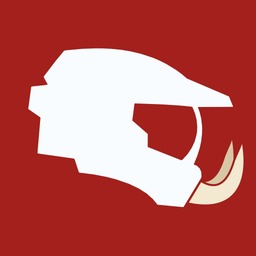

<p align="center"></p>

<h1 align="center">Warthog for Switch</h1>

<p align="center"><b>Chupathingy on the Nintendo Switch, playing online with the PCs and the Xbox.</b></p>

<p align="center">
<a href="https://github.com/ChupathingyCE/chupathingyce">The game (Chupathingy)</a> ·
<a href="https://stats.chupathingy.org">Games online now</a> ·
<a href="https://chupathingy.org">chupathingy.org</a> ·
<a href="https://discord.gg/chupathingy">Discord</a>
</p>

<p align="center">
<a href="LICENSE"></a>
<a href="https://github.com/ChupathingyCE/warthog-switch/actions/workflows/build.yml?query=branch%3Amain+event%3Apush"></a>
<a href="https://discord.gg/chupathingy"></a>
</p>

Warthog for Switch is the Halo: Combat Evolved decompilation built for the
Nintendo Switch, on the same game code as
[Chupathingy](https://github.com/ChupathingyCE/chupathingyce) (the Windows,
Mac, Linux and Android builds) and
[Warthog](https://github.com/ChupathingyCE/warthog-xbox) (the original Xbox).
It runs as homebrew on a Switch with Atmosphère, with no emulator, and joins
the same games as the PCs and the Xbox from the **Online Games** list or
System Link.

This repository holds the Switch's own code. The game is the `chupathingyce`
submodule, and the shared code's console hooks live there.

You need your own copy of Halo. No game files are included, and nothing from
Nintendo's SDK: the port is built with devkitPro's free tools.

## Status

Working. It boots and plays on Switch hardware. The port is maintained by
[thelinkin3000](https://github.com/thelinkin3000).

The newest release is
[0.8.1d (build 6)](https://github.com/ChupathingyCE/warthog-switch/releases/latest).
The Build workflow builds every change on main, and its artifact is the
newest test build.

What works:

- Online Games (**Multiplayer > ONLINE GAMES**) lists the games online and
  joins them, dedicated servers too.
- It speaks the game's wire, `chupa-41a`. It joins hosts of network versions
  11 through 41, OpenCE's newest, as the signed compatibility table allows.
- You can host from the console, with up to 48 players. That is the most it
  was measured to hold.
- Other players see you as a Switch. A host gives a Switch games of 16
  players unless it sets `network.platform_limits = "off"`.
- System Link joins PC hosts and consoles on your network.
- Link Profile links the console to your Delta profile on
  [stats.chupathingy.org](https://stats.chupathingy.org). Your games then
  count toward you.
- The game draws 720 lines by default. It is scaled to 1280x720 in your
  hands or 1920x1080 docked. Docking and undocking switch at once.
- Gyro aiming works from the console in your hands, a Pro Controller or a
  Joy-Con.
- The Xbox disc's campaign and multiplayer maps play, and so do Halo PC's
  Custom Edition maps.
- A release build checks for a newer release when it starts and offers it.

Not yet: the shared shader keys that would make a new console's first start
quicker.

## What you need

- A Switch that runs homebrew (Atmosphère).
- About 2 GB free on the SD card, for the maps and the shader cache.
- Your own Halo disc's maps. Use the North American (NTSC) release,
  01.10.12.2276, as every Chupathingy build and server does. The PAL disc's
  maps work too. Warthog never provides maps, disc images or other game
  data, and never links to them. Don't share yours.
- For online play, a certificate bundle called `cacert.pem`. Mozilla's is at
  [curl.se/docs/caextract.html](https://curl.se/docs/caextract.html). Your
  computer's `ca-certificates.crt` works too. The console has none that the
  game list can use.

## Getting started

### Install

1. Download `halo-switch-release.zip` from the
   [latest release](https://github.com/ChupathingyCE/warthog-switch/releases/latest).
2. Unzip it to `sd:/switch/ChupaThingyCE/` on the SD card. The folder now
   has `halo.nro`, `halo_guest.elf`, `menus/` and `brokers.txt`.
3. Add your maps. Copy the `maps` folder from your own disc to
   `sd:/switch/ChupaThingyCE/maps/`.
4. Or put your disc image in the folder as `halo.iso` instead. `.xiso` and
   `.bin` work too. The first start unpacks `maps/` from it. That writes
   about 1.7 GB and takes a few minutes.
5. Put `cacert.pem` in the same folder, for online play.
6. Start `halo.nro` from the Homebrew Menu.

The first start writes `config.toml` and compiles the shaders the menus need.
The loading screen waits for them. The shader cache on the card keeps them
for next time.

### Updating

A release build checks GitHub for a newer release when it starts and offers
it. The program is replaced at once. The game and the menu files are
replaced at the next start. Set `update.auto = false` in `config.toml` to
turn the check off.

To update by hand, unzip the new `halo-switch-release.zip` over the folder.
Your maps, saves and `config.toml` stay.

Builds you make yourself have no build number, and never check.

### Where things go

Everything is in `sd:/switch/ChupaThingyCE/`:

| What | Where |
| --- | --- |
| The program and the game | `halo.nro`, `halo_guest.elf` |
| Settings | `config.toml` |
| Retail maps | `maps/` |
| Custom Edition maps | `maps_ce/` |
| Saves | `save/` |
| The game's log | `logs/debug.txt` |
| The program's log | `halo.log` |
| Certificates for online play | `cacert.pem` |

### Custom Edition maps

Halo PC's Custom Edition maps go in `sd:/switch/ChupaThingyCE/maps_ce/`.
Put Custom Edition's `bitmaps.map`, `sounds.map` and `loc.map` in the same
folder. A map in a subfolder is listed under the folder's name. Campaign
maps show under CUSTOM SINGLEPLAYER and multiplayer maps under CUSTOM
MULTIPLAYER. One level of folders is read.

The older `custom_maps/` folder is still read.

When you join a game with a map you don't have, it is downloaded from the
host while you wait in the lobby.

### The Ultrahand overlay

[OpenCE-Ultrahand](https://github.com/hardran3/OpenCE-Ultrahand) by
hardran3 is a package for the
[Ultrahand Overlay](https://github.com/ppkantorski/Ultrahand-Overlay). It
turns on cheats (god mode, infinite ammo, super jump and more) and reverts
to the last checkpoint. It also changes V-Sync, interpolation and the frame
rate display without leaving the game. It needs Ultrahand 2.5.3 or later.

When the overlay is installed, the main menu says "Ultrahand Overlay present
and enabled". Set `game.overlay_commands = false` in `config.toml` to make
the game ignore it.

## Settings

The settings are in `sd:/switch/ChupaThingyCE/config.toml`. The first start
writes it with every setting, commented out at its default. Remove the `# `
in front of one, change its value and save. Most change at once. The rest
take effect at the next start.

Most settings are the same as on the PC and Android builds. These are the
Switch's own:

| Setting | Default | What it does |
| --- | --- | --- |
| `display.resolution_limit` | `"720"` | The lines the game draws: `"480"`, `"720"`, `"900"` or `"1080"`. The picture is scaled to the screen. In your hands it draws no more than 720. |
| `display.dynamic_resolution` | `false` | Draw one step lower while the frame rate falls under 55. It goes back up when there is room. |
| `display.big_sprite_limit` | `8` | The most big sprites drawn in a frame. A big sprite covers more than half the view. The Xbox drew 11. |
| `performance.cpu_clock` | `"1785"` | The CPU's speed. `"1785"` is 1.7 GHz. `"1020"` is 1 GHz, which runs cooler and saves battery. `"stock"` leaves it alone. |
| `input.gyro_aim` | `"false"` | Aim with the gyroscope: `"true"` always, `"zoom"` only while zoomed in, `"false"` never. |
| `input.gyro_sensitivity_horizontal` | `1.0` | How far the view turns left and right with the gyroscope, from 0.25 to 10. |
| `input.gyro_sensitivity_vertical` | `1.0` | How far the view turns up and down with the gyroscope, from 0.25 to 10. |
| `input.gyro_invert_horizontal` | `false` | Turn the gyroscope's left and right around. |
| `input.gyro_invert_vertical` | `false` | Turn the gyroscope's up and down around. |
| `game.overlay_commands` | `true` | Take commands from the Ultrahand overlay. |
| `game.terminal_output` | `"menus"` | Where the game's messages show at the bottom left: `"menus"`, `"console"`, `"always"` or `"none"`. |
| `debug.log_files` | `true` | Write `debug.txt` and `halo.log`. With `false` nothing is kept to say what went wrong. |
| `update.auto` | `true` | Check for a newer release at start. |

Video Setup has rows for the resolution limit, dynamic resolution and the
CPU clock. The gyro settings are on the GYRO page of Controls Setup. There
is no QUIT on the main menu. Press HOME to leave.

The other `debug.*` settings in the file are for finding renderer and
performance problems. Leave them at their defaults unless someone asks you
to change one. [port/switch/README.md](port/switch/README.md) explains them.

## Reporting problems

1. Right after the problem, copy `logs/debug.txt` and `halo.log` from
   `sd:/switch/ChupaThingyCE/` to your computer.
2. Send them at [dump.chupathingy.org](https://dump.chupathingy.org), with
   "Switch" as the platform. You get a reference code.
3. Tell us in #warthog-support on the
   [Discord](https://discord.gg/chupathingy) what you were doing, and give
   the code.

## Troubleshooting

- **It says the maps are missing.** The game looks for
  `sd:/switch/ChupaThingyCE/maps/ui.map`. Check the folder name, or put
  your disc image in the folder as `halo.iso`.
- **Online Games shows no games.** Put `cacert.pem` in
  `sd:/switch/ChupaThingyCE/`. Without it the list can't be fetched, and the
  log says so at start.
- **The first play of a level stutters.** Shaders the console hasn't seen
  yet are compiled when a level first needs them. The cache keeps each one,
  so it happens once.
- **A checkpoint is lost after a restart.** A checkpoint saved in one run is
  sometimes not found in the next, and the level starts over. This is a
  known bug.
- **The overlay does nothing.** Check that Ultrahand is 2.5.3 or later, and
  that `game.overlay_commands` isn't `false`. The main menu says when the
  game sees the overlay.

## Building it yourself

Clone with the game:

```sh
git clone --recursive https://github.com/ChupathingyCE/warthog-switch.git
cd warthog-switch
```

(In a clone you already have: `git submodule update --init`. After a
`git pull`, `git submodule update` moves the game to the version this
repository uses.)

You need:
- [devkitPro](https://devkitpro.org) with `devkitA64`, `libnx`, `deko3d`,
  `switch-sdl2`, `switch-mesa` and `switch-libdrm_nouveau`
  (`sudo dkp-pacman -S --needed devkitA64 libnx deko3d switch-sdl2 switch-mesa switch-libdrm_nouveau`).
- The Android NDK, for the game's half (`ANDROID_NDK_HOME`, or
  `--android-ndk DIR`).
- Python 3, [ninja](https://ninja-build.org/) and clang.
- For the shader compiler built into the program (UAM, deko3d's): meson,
  flex, bison 3 and Python's mako. Without them the program still builds,
  and then has only the shaders already on the card.
- A network connection for the first build: `configure.py` downloads musl,
  SDL and UAM to `build/switch/third_party`.

Build:

```sh
python3 chupathingyce/configure.py --console-port port/switch [--devkitpro DIR] [--android-ndk DIR] [--release]
ninja switch                        # build/switch/halo.nro, halo_guest.elf and menus/
python3 tools/switch_package.py --maps /path/to/maps --out ~/Downloads/warthog-switch
```

`tools/switch_package.py` lays out the card's folder with your maps.
`tools/switch_deploy.py` sends a build to a console running an FTP server.
That can be the Homebrew Menu's ftpd, or the sys-ftpd module, which stays up
while the game runs.

`configure.py` is the game's, and `port/switch/build.py` adds the Switch's
targets to it; the game's
[docs/building.md](https://github.com/ChupathingyCE/chupathingyce/blob/main/docs/building.md),
"Console ports", has the layout and the options every console takes.
`--release` makes the release build; without it the build is the debug one,
which stops at the first failed assertion and logs it.

The [Build workflow](.github/workflows/build.yml) is the same build in
devkitPro's container, with the NDK and LLVM's clang added to the image: a
way to build without a devkitPro install, and the set-up to copy for Docker
on your computer. The [Release workflow](.github/workflows/release.yml)
builds both flavours for a pushed tag `v<version>` (`v0.8.0d-beta1`, say) and
publishes the release `build-<number>`, numbered by the run, which the
installed builds offer to update to.

[port/switch/README.md](port/switch/README.md) has the port's own account:
the host and the guest, the memory model, the SDL shim, internet play and
the development tools. [port/switch/DEKO3D.md](port/switch/DEKO3D.md) is the
renderer's. Changes to the game itself go to
[ChupathingyCE/chupathingyce](https://github.com/ChupathingyCE/chupathingyce),
behind `HALO_SWITCH_CONSOLE` where they are the console's alone.

## Generative AI

The port was made with heavy use of generative AI tools, the way the game
is: a person decides what to build, reviews every change, tests it on the
console and is responsible for it. The game's
[policy](https://github.com/ChupathingyCE/chupathingyce/blob/main/CONTRIBUTING.md#using-ai-tools)
applies to contributions here.

## License

Warthog for Switch is free software: you can redistribute it and modify it
under the terms of the GNU General Public License as published by the Free
Software Foundation, either version 3 of the License or (at your option) any
later version (`GPL-3.0-or-later`). It comes with no warranty. The full text
is in [LICENSE](LICENSE).

- **The Switch port** is thelinkin3000's work, contributed under
  GPL-3.0-or-later.
- **The game** (`chupathingyce/`) is under its own repository's license,
  with its third-party code, fonts and art under theirs.
- **Third-party code** keeps its own license, which goes beside it:
  nanosvg (zlib) in `port/switch/third_party`. The build links devkitPro's
  libnx (ISC), deko3d (zlib), SDL2 and Mesa from your devkitPro install, and
  builds deko3d's shader compiler UAM (zlib) into the program from its own
  download; none of them is included here.
- **No console SDK.** The port is built only with free, legally available
  tools and libraries. Nothing from Nintendo's SDK is in this repository,
  and none of it may be committed.
- **Halo itself is not covered.** The license covers the work of this
  repository's and Chupathingy's authors. It gives no rights in Halo, its
  maps or anything else Microsoft owns.

## Support

Chupathingy is free and always will be. Support through
[Ko-fi](https://ko-fi.com/milenko) goes to running the site and the servers. If
there's a specific developer or port you'd like to support, ask them: they may
not be part of our community.

## Credits

- The decompilation: [punpckhdq/halo](https://github.com/punpckhdq/halo) and
  [bnunu/halo-1](https://github.com/bnunu/halo-1), of the Xbox build 2342.
- The game: [Chupathingy](https://github.com/ChupathingyCE/chupathingyce)
  and its contributors, and OpenCE and its contributors before it.
- Warthog, the consoles' line: [Milenko](https://github.com/MrMilenko) and
  contributors.
- The Switch port: [thelinkin3000](https://github.com/thelinkin3000), its
  maintainer, and **puginatux**.
- The Ultrahand package: [hardran3](https://github.com/hardran3)
  ([OpenCE-Ultrahand](https://github.com/hardran3/OpenCE-Ultrahand)).
- The toolchain and libraries: [devkitPro](https://devkitpro.org) (devkitA64,
  libnx, deko3d, UAM), SDL2, Mesa, and the libraries the game uses, with
  their licenses in the game's `port/third_party`.

## Links

- The game: [ChupathingyCE/chupathingyce](https://github.com/ChupathingyCE/chupathingyce)
- The Xbox: [ChupathingyCE/warthog-xbox](https://github.com/ChupathingyCE/warthog-xbox)
- Games online now: [stats.chupathingy.org](https://stats.chupathingy.org)
- Discord: [discord.gg/chupathingy](https://discord.gg/chupathingy)
  (#warthog-support for help, #warthog-dev for development)

Halo is a trademark of Microsoft, and Nintendo Switch a trademark of
Nintendo. Warthog for Switch is a fan project, not made or endorsed by
Microsoft, Bungie, 343 Industries or Nintendo, and includes none of the
game's content. The code is released under the GNU GPL, version 3 or later
(see [License](#license)).
