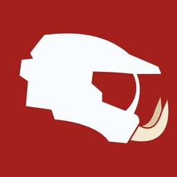

<p align="center"></p>

<h1 align="center">Warthog for Switch</h1>

<p align="center"><b>Chupathingy on the Nintendo Switch, playing online with the PCs and the Xbox.</b></p>

<p align="center">
<a href="https://github.com/ChupathingyCE/chupathingyce">The game (Chupathingy)</a> ·
<a href="https://stats.chupathingy.org">Games online now</a> ·
<a href="https://chupathingy.org">chupathingy.org</a> ·
<a href="https://discord.gg/chupathingy">Discord</a>
</p>

<p align="center">
<a href="LICENSE"></a>
<a href="https://github.com/ChupathingyCE/warthog-switch/actions/workflows/build.yml?query=branch%3Amain+event%3Apush"></a>
<a href="https://discord.gg/chupathingy"></a>
</p>

Warthog for Switch is the Halo: Combat Evolved decompilation built for the
Nintendo Switch, on the same game code as
[Chupathingy](https://github.com/ChupathingyCE/chupathingyce) (the Windows,
Mac, Linux and Android builds) and
[Warthog](https://github.com/ChupathingyCE/warthog-xbox) (the original Xbox).
It runs as homebrew on a Switch with Atmosphère, with no emulator, and joins
the same games as the PCs and the Xbox from the **Online Games** list or
System Link.

This repository holds the Switch's own code. The game is the `chupathingyce`
submodule, and the shared code's console hooks live there.

You need your own copy of Halo. No game files are included, and nothing from
Nintendo's SDK: the port is built with devkitPro's free tools.

## Status

**Working: boots and plays on Switch hardware (October 2026).** The port is
maintained by [thelinkin3000](https://github.com/thelinkin3000). There is no
release yet; the Build workflow builds every change, and a release is one
pushed tag away (below).

- **Network version:** the game's, 32 (wire `chupa-32a`). Joins hosts of
  network versions 11 through 33.
- **Online:** **Multiplayer > ONLINE GAMES** lists the games online and
  joins them through the PCs' own tunnel, dedicated servers too. Hosting from
  the console works, up to 48 players, the most it was measured to hold.
  **Link Profile** links the console to your Delta profile on
  [stats.chupathingy.org](https://stats.chupathingy.org), so your games count
  toward you.
- **System Link:** joins PC hosts and consoles on your network.
- **Display:** 720 lines by default, drawn and scaled to the console's
  1280x720 in the hands or 1920x1080 docked; 480, 900 or 1080 by choice, and
  dynamic resolution that steps down while the GPU falls behind. Docking and
  undocking switch at once.
- **Gyro aiming:** with the gyroscope all the time or only while zoomed in,
  from the console in the hands, a Pro Controller or a Joy-Con, with
  sensitivity and inversion of its own. Each local player reads their own
  controller.
- **Maps:** the Xbox disc's campaign and multiplayer maps, unpacked from a
  disc image by the console itself; Halo PC's Custom Edition maps too, in
  `custom_maps/`.
- **Menus:** Chupathingy's, with the console's rows added in Video Setup
  (RESOLUTION LIMIT, DYNAMIC RESOLUTION, CPU CLOCK) and the GYRO page in
  Controls Setup. There is no QUIT: the HOME button is the way out.
- **Updates itself:** a release build looks for a newer release when it
  starts and offers it (`update.auto` turns that off).
- **Not yet:** a release, and the shared shader keys that would make a new
  console's first start quicker.

## What you need

- **A Switch that runs homebrew** (Atmosphère), with about 2 GB free on its
  SD card for the maps and the shader cache.
- **Your own Halo disc's maps.** The North American (NTSC) release,
  01.10.12.2276, as every Chupathingy build and server uses. The PAL disc's
  maps work too. Warthog never provides maps, disc images or other game
  data, and never links to them. Don't share yours.
- **For online play:** a certificate bundle, `cacert.pem` (Mozilla's from
  [curl.se/docs/caextract.html](https://curl.se/docs/caextract.html), or your
  computer's `ca-certificates.crt`), beside the game. The console keeps no
  certificate authorities where the game list's HTTPS can find them.
- **To build it** (below): devkitPro with devkitA64, libnx, deko3d and the
  Switch portlibs; the Android NDK, which builds the game's half; Python 3,
  Ninja and clang.

## Install

1. Get the card's folder: the latest release's `halo-switch-release.zip`
   when there is one, the Build workflow's artifact on this repository's
   Actions page, or your own build (see "Building it yourself").
2. Unzip it to `sd:/switch/ChupaThingyCE/` on the card, so `halo.nro` (the
   program), `halo_guest.elf` (the game), `menus/` and `brokers.txt` are in
   that folder.
3. Add your maps, one of two ways. Copy the `maps` folder from your own disc
   into the folder, as `sd:/switch/ChupaThingyCE/maps/`. Or put the disc
   image in the folder as `halo.iso` (`.xiso` and `.bin` work too), and the
   game unpacks `maps/` from it on its first start: about 1.7 GB, a few
   minutes, with the log saying how far it has got.
4. For online play, put `cacert.pem` in the same folder.
5. Start `halo.nro` from the Homebrew Menu. The first start writes
   `config.toml` and compiles the shaders it needs; the loading screen waits
   for them, and the shader cache on the card keeps them for the next time.

With a build of your own, `tools/switch_package.py --maps /path/to/maps
--out DIR` lays the folder out with your maps, and `tools/switch_deploy.py`
sends a build to a console running an FTP server (the Homebrew Menu's ftpd,
or the sys-ftpd module, which stays up while the game runs).

## Useful log files

The program writes its log to `halo.log` and the game to `logs/debug.txt`,
both in the game's folder. Attach them to bug reports.

## Known quirks

- **The first play of a level.** Shaders the console has not met yet are
  compiled as a level first needs them; the first seconds of a new level
  wait on them, and the frame rate can dip while the rest compile in the
  background. The cache on the card keeps every one, so each happens once.
- **Checkpoints after a restart.** A checkpoint saved in one run is sometimes
  not found in the next, and the level starts over from its beginning. Being
  fixed.
- **No game list without `cacert.pem`.** ONLINE GAMES draws, but the list
  cannot be fetched, and the log says so at start.

## Building it yourself

Clone with the game:

```sh
git clone --recursive https://github.com/ChupathingyCE/warthog-switch.git
cd warthog-switch
```

(In a clone you already have: `git submodule update --init`. After a
`git pull`, `git submodule update` moves the game to the version this
repository uses.)

You need:
- [devkitPro](https://devkitpro.org) with `devkitA64`, `libnx`, `deko3d`,
  `switch-sdl2`, `switch-mesa` and `switch-libdrm_nouveau`
  (`sudo dkp-pacman -S --needed devkitA64 libnx switch-sdl2 switch-mesa switch-libdrm_nouveau`).
- The Android NDK, for the game's half (`ANDROID_NDK_HOME`, or
  `--android-ndk DIR`).
- Python 3, [ninja](https://ninja-build.org/) and clang.
- For the shader compiler built into the program (UAM, deko3d's): meson,
  flex, bison 3 and Python's mako. Without them the program still builds,
  and then has only the shaders already on the card.
- A network connection for the first build: `configure.py` downloads musl,
  SDL and UAM to `build/switch/third_party`.

Build:

```sh
python3 chupathingyce/configure.py --console-port port/switch [--devkitpro DIR] [--android-ndk DIR] [--release]
ninja switch                        # build/switch/halo.nro, halo_guest.elf and menus/
python3 tools/switch_package.py --maps /path/to/maps --out ~/Downloads/warthog-switch
```

`configure.py` is the game's, and `port/switch/build.py` adds the Switch's
targets to it; the game's
[docs/building.md](https://github.com/ChupathingyCE/chupathingyce/blob/main/docs/building.md),
"Console ports", has the layout and the options every console takes.
`--release` makes the release build; without it the build is the debug one,
which stops at the first failed assertion and logs it.

The [Build workflow](.github/workflows/build.yml) is the same build in
devkitPro's container, with the NDK and LLVM's clang added to the image: a
way to build without a devkitPro install, and the set-up to copy for Docker
on your computer. The [Release workflow](.github/workflows/release.yml)
builds both flavours for a pushed tag `v<number>` and publishes the release
`build-<number>`, which the installed builds offer to update to.

[port/switch/README.md](port/switch/README.md) has the port's own account:
the host and the guest, the memory model, the SDL shim, internet play and
the development tools. [port/switch/DEKO3D.md](port/switch/DEKO3D.md) is the
renderer's. Changes to the game itself go to
[ChupathingyCE/chupathingyce](https://github.com/ChupathingyCE/chupathingyce),
behind `HALO_SWITCH_CONSOLE` where they are the console's alone.

## Generative AI

The port was made with heavy use of generative AI tools, the way the game
is: a person decides what to build, reviews every change, tests it on the
console and is responsible for it. The game's
[policy](https://github.com/ChupathingyCE/chupathingyce/blob/main/CONTRIBUTING.md#using-ai-tools)
applies to contributions here.

## License

Warthog for Switch is free software: you can redistribute it and modify it
under the terms of the GNU General Public License as published by the Free
Software Foundation, either version 3 of the License or (at your option) any
later version (`GPL-3.0-or-later`). It comes with no warranty. The full text
is in [LICENSE](LICENSE).

- **The Switch port** is thelinkin3000's work, contributed under
  GPL-3.0-or-later.
- **The game** (`chupathingyce/`) is under its own repository's license,
  with its third-party code, fonts and art under theirs.
- **Third-party code** keeps its own license, which goes beside it:
  nanosvg (zlib) in `port/switch/third_party`. The build links devkitPro's
  libnx (ISC), deko3d (zlib), SDL2 and Mesa from your devkitPro install, and
  builds deko3d's shader compiler UAM (zlib) into the program from its own
  download; none of them is included here.
- **No console SDK.** The port is built only with free, legally available
  tools and libraries. Nothing from Nintendo's SDK is in this repository,
  and none of it may be committed.
- **Halo itself is not covered.** The license covers the work of this
  repository's and Chupathingy's authors. It gives no rights in Halo, its
  maps or anything else Microsoft owns.

## Support

Chupathingy is free and always will be. Support through
[Ko-fi](https://ko-fi.com/milenko) goes to running the site and the servers. If
there's a specific developer or port you'd like to support, ask them: they may
not be part of our community.

## Credits

- The decompilation: [punpckhdq/halo](https://github.com/punpckhdq/halo) and
  [bnunu/halo-1](https://github.com/bnunu/halo-1), of the Xbox build 2342.
- The game: [Chupathingy](https://github.com/ChupathingyCE/chupathingyce)
  and its contributors, and OpenCE and its contributors before it.
- Warthog, the consoles' line: [Milenko](https://github.com/MrMilenko) and
  contributors.
- The Switch port: [thelinkin3000](https://github.com/thelinkin3000), its
  maintainer, and **puginatux**.
- The toolchain and libraries: [devkitPro](https://devkitpro.org) (devkitA64,
  libnx, deko3d, UAM), SDL2, Mesa, and the libraries the game uses, with
  their licenses in the game's `port/third_party`.

## Links

- The game: [ChupathingyCE/chupathingyce](https://github.com/ChupathingyCE/chupathingyce)
- The Xbox: [ChupathingyCE/warthog-xbox](https://github.com/ChupathingyCE/warthog-xbox)
- Games online now: [stats.chupathingy.org](https://stats.chupathingy.org)
- Discord: [discord.gg/chupathingy](https://discord.gg/chupathingy)
  (#warthog-support for help, #warthog-dev for development)

Halo is a trademark of Microsoft, and Nintendo Switch a trademark of
Nintendo. Warthog for Switch is a fan project, not made or endorsed by
Microsoft, Bungie, 343 Industries or Nintendo, and includes none of the
game's content. The code is released under the GNU GPL, version 3 or later
(see [License](#license)).
